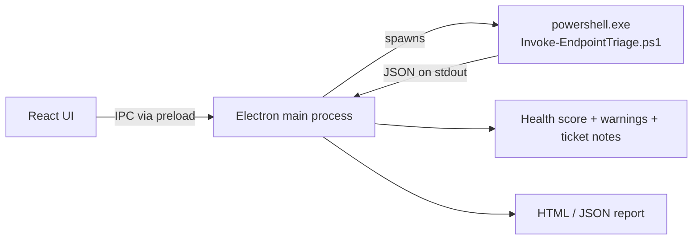

# Endpoint Triage Pro

[](https://github.com/Jhesse00/endpoint-triage-pro/actions/workflows/ci.yml)


One-click Windows endpoint triage for help desk tickets. A PowerShell collector gathers network, storage, security, update, event log, printer, and mapped-drive data. The Electron desktop app scores machine health, flags issues, writes ticket notes, and exports HTML/JSON reports.

**[Download for Windows (v0.1.0)](https://github.com/Jhesse00/endpoint-triage-pro/releases/latest)** · [Release notes and SHA-256 checksums](https://github.com/Jhesse00/endpoint-triage-pro/releases/tag/v0.1.0)

Screenshots are not included. Add screenshots only after capturing them on a sanitized lab VM and checking them for identifying data.

## What it collects

| Area | Data | Used for |
|---|---|---|
| Network | IP addresses, DNS servers, gateway, adapters, domain/workgroup | Connectivity and name-resolution tickets |
| Storage & memory | Free space per drive, RAM usage, CPU load | Slowness and disk-full tickets |
| Security | BitLocker, Defender, firewall profiles, local admins | Compliance checks |
| Updates | Recent hotfixes, pending reboot | Patch status |
| Events | Failed sign-ins (24h), recent system and app errors | Account lockouts, crashes |
| Devices | Printers and spooler, mapped drives | Printing and file-share tickets |

It does **not** collect passwords, files, browser history, tokens, cookies, or clipboard data. Reports stay on the machine unless a technician exports them.

## How it works



## Health score

Starts at 100 and subtracts for each matching condition (`src/lib/healthScore.ts`; characterization tests in `src/lib/healthScore.test.ts`). Each listed condition deducts once, even when multiple items match.

| Condition | Points |
|---|---:|
| Defender disabled | −20 |
| BitLocker off, any firewall profile off, any drive under 10 GB free, any drive under 10% free, critical system errors | −15 each |
| Pending reboot, application errors, RAM over 90% | −10 each |
| Uptime over 14 days, failed sign-ins in 24h, disconnected mapped drive, print spooler stopped | −8 each |

90+ Healthy · 75+ Good · 60+ Needs Attention · 40+ Poor · below 40 Critical.

## Run the collector alone

```powershell
powershell.exe -NoProfile -ExecutionPolicy Bypass -File .\scripts\Invoke-EndpointTriage.ps1 > .\reports\sample-report.json
```

Run as administrator for full BitLocker, event log, and security results. Without admin rights, the script returns available data and can mark restricted fields.

## Build from source

Install dependencies:

```bash
npm ci
```

Run the desktop app in development:

```bash
npm run electron:dev
```

Run the renderer only:

```bash
npm run dev
```

Verify and test:

```bash
npm run typecheck
npm test
npm run build:all
```

Build Windows installer and portable targets on Windows:

```bash
npm run dist:win
```

The packaged Windows executable is configured as `EndpointTriagePro.exe`. Reports are written to the local Electron user data folder in packaged builds, not bundled into installers.

## Privacy

The collector runs locally. The app stores reports locally and only shares them when a technician explicitly exports or sends them. Review report contents before sharing; reports can contain hostnames, usernames, IP addresses, serial numbers, and event details.

## Release

The v0.1.0 installer and portable executable are unsigned. Windows SmartScreen may warn on first run. Verify downloaded files using SHA-256 values in the [release notes](https://github.com/Jhesse00/endpoint-triage-pro/releases/tag/v0.1.0). Run as administrator for full BitLocker, event log, and security results.
