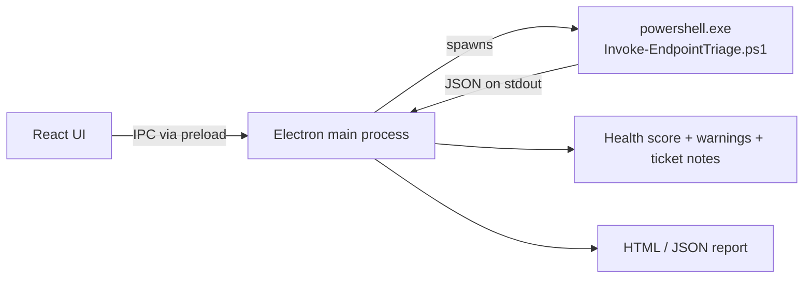

# Endpoint Triage Pro

[](https://github.com/Jhesse00/endpoint-triage-pro/actions/workflows/ci.yml)

Endpoint Triage Pro is a Windows desktop app for help desk triage. A PowerShell collector gathers network, storage, security, update, event log, printer, and mapped-drive data from the local machine. The Electron app scores machine health, lists warnings, drafts ticket notes, and exports HTML and JSON reports.

Screenshots: pending UI update.

## Features

| Area | Data | Used for |
|---|---|---|
| Network | IP addresses, DNS servers, gateway, adapters, domain/workgroup | Connectivity and name-resolution tickets |
| Storage and memory | Free space per drive, RAM usage, CPU load | Slowness and disk-full tickets |
| Security | BitLocker, Defender, firewall profiles, local admins | Compliance checks |
| Updates | Recent hotfixes, pending reboot | Patch status |
| Events | Failed sign-ins (24h), recent system and app errors | Account lockouts, crashes |
| Devices | Printers and spooler, mapped drives | Printing and file-share tickets |

- Health score and warnings for each scan.
- Ticket notes built from scan results.
- Local scan history.
- HTML and JSON report export.

The collector does not gather passwords, files, browser history, tokens, cookies, or clipboard data.



## Health score

Starts at 100 and subtracts for each matching condition (`src/lib/healthScore.ts`; characterization tests in `src/lib/healthScore.test.ts`). Each listed condition deducts once, even when multiple items match.

| Condition | Points |
|---|---:|
| Defender disabled | −20 |
| BitLocker off, any firewall profile off, any drive under 10 GB free, any drive under 10% free, critical system errors | −15 each |
| Pending reboot, application errors, RAM over 90% | −10 each |
| Uptime over 14 days, failed sign-ins in 24h, disconnected mapped drive, print spooler stopped | −8 each |

90+ Healthy · 75+ Good · 60+ Needs Attention · 40+ Poor · below 40 Critical.

## Requirements

- Windows with Windows PowerShell 5.1 or later.
- Administrator rights are optional. Run as administrator for full BitLocker, event log, and security results. Without admin rights, the collector returns available data and marks restricted fields.

## Install

Download the installer or the portable executable from [release v0.1.0](https://github.com/Jhesse00/endpoint-triage-pro/releases/tag/v0.1.0), then compare its hash with the SHA-256 value in the release notes:

```powershell
Get-FileHash '.\Endpoint Triage Pro 0.1.0.exe' -Algorithm SHA256
```

The v0.1.0 builds are not code-signed, so Windows SmartScreen may warn on first run.

## Build from source

```bash
npm ci
npm run electron:dev   # run the desktop app in development
npm run dev            # run the renderer only
npm run dist:win       # build Windows installer and portable targets
```

The packaged executable is configured as `EndpointTriagePro.exe`. Packaged builds write reports to the Electron user data folder; development runs write to `reports/`.

Run the collector alone:

```powershell
powershell.exe -NoProfile -ExecutionPolicy Bypass -File .\scripts\Invoke-EndpointTriage.ps1 > .\reports\sample-report.json
```

## Tests

```bash
npm run typecheck
npm test
npm run build:all
```

CI runs these steps on `windows-latest` for pull requests.

## Privacy

The collector runs locally. Reports stay on the machine unless a technician exports them. Reports can contain hostnames, usernames, IP addresses, serial numbers, and event details; review them before sharing.

## License

MIT. See [LICENSE](LICENSE).
